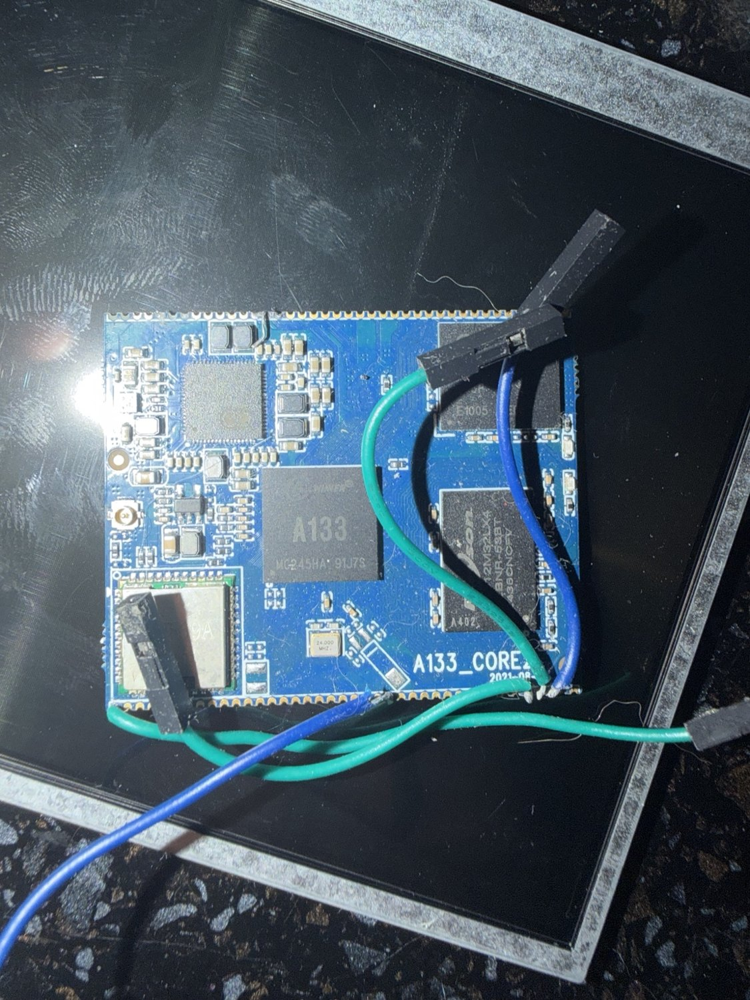
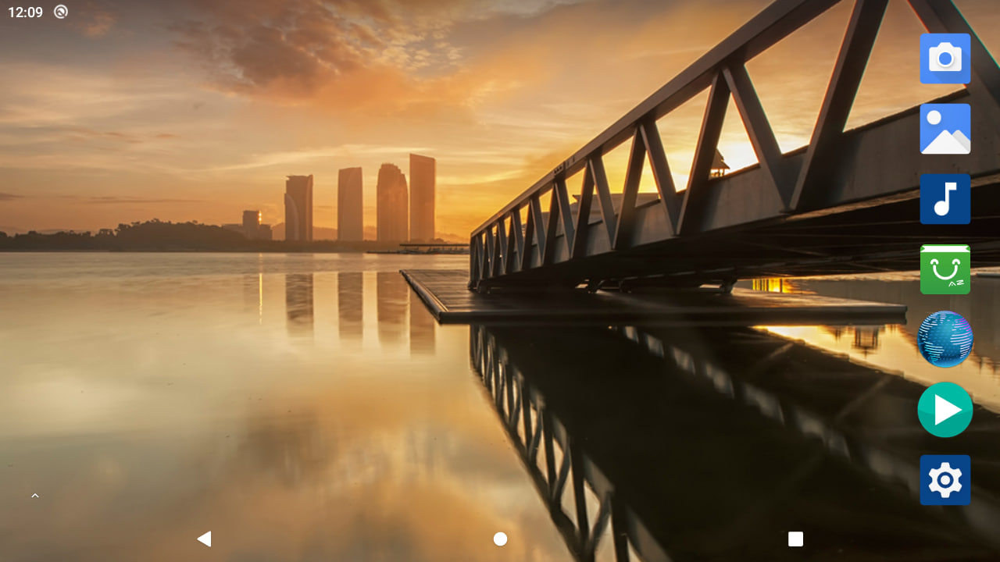
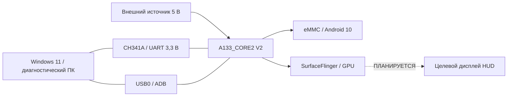

<div align="center">

# MOTO EYE

### Вычислительная платформа для интеллектуального дисплея мотошлема

**Allwinner A133 · Android 10 · UART · USB ADB · Head-up display**

*От восстановления низкоуровневой загрузки — к независимой носимой системе визуальной информации.*

</div>

<div align="center">
  
</div>

> **Состояние на 04.11.2026:** работающий вычислительный стенд. Android 10 загружен с eMMC; UART0 доступен; ПК обнаруживает устройство через USB ADB; доступ к оболочке получен с `uid=0(root)`; SurfaceFlinger формирует интерфейс 1280 × 720. Физический дисплей на шлеме, HUD-приложение и интеграция датчиков **ещё не реализованы**.

## О проекте

**MOTO EYE** — разрабатываемая система визуального сопровождения поездки, в которой вычислительный модуль на базе Allwinner A133 отвечает за обработку данных и вывод минималистичного интерфейса на небольшой дисплей в поле зрения водителя. Концепция предполагает работу с навигацией, параметрами движения, статусом связи и уведомлениями без необходимости постоянно смотреть на смартфон. Это целевая архитектура, а не описание уже работающих функций.

Текущая реализация — технический фундамент продукта: прошивка, ОС, отладочные интерфейсы, проверенная графическая подсистема и воспроизводимые средства диагностики. Разработка началась с восстановительных работ на отдельном модуле **A133_CORE2 V2** без подключённого целевого экрана.

## Текущее состояние

| Подсистема | Подтверждённый результат | Статус |
| :-- | :-- | :-- |
| Вычислительный модуль | Allwinner A133, 4 ядра, 2 ГиБ RAM, eMMC ≈ 14,6 GiB | ✅ Проверено журналом |
| Низкоуровневая загрузка | BOOT0 → U-Boot 2018.05 → Linux 4.9.170 → Android | ✅ |
| Операционная система | Android 10, `sys.boot_completed=1` | ✅ |
| Диагностика UART | UART0, 115200 8N1, двусторонняя shell-коммуникация | ✅ |
| USB-отладка | `adb devices -l` → `device` | ✅ |
| Привилегии | `uid=0(root)`, SELinux context `u:r:su:s0` | ✅ На стенде |
| Графический стек | SurfaceFlinger / Display 0, 1280 × 720, 200 dpi | ✅ Программно |
| Стабильность | Зарегистрировано 667,73 с непрерывной работы при активном ADB | ✅ Контрольное наблюдение |
| Дисплей на шлеме | Подключение, электрика, оптика | ⬜ Не проверено |
| Специальное HUD-приложение | Навигация, скорость, уведомления | ⬜ Запланировано |



*Рис. 1 — кадр 1280 × 720, сохранённый программно через Android Debug Bridge. Подтверждает формирование изображения, но не физическое отображение через MIPI/HDMI/LVDS.*

## Архитектура стенда



**Электробезопасность:** схема иллюстрирует роли соединений, а не способ подключения проводов. Стабильный доступ через USB не заменяет проверку линий VBUS и топологии питания. Перед повторением схемы прочитайте [аппаратную часть](docs/hardware.md) и [раздел об электропитании](docs/power-and-usb.md).

## Как воспроизвести диагностику

Требуется Windows 11 / PowerShell 5.1+ и Android SDK Platform-Tools. Для низкоуровневого мониторинга — USB–UART адаптер с уровнями **3,3 В**. На проверенном стенде UART назначен на `COM6`, а `adb.exe` расположен в пользовательском каталоге `AndroidTools\platform-tools`.

```powershell
# Проверить подключение Android по USB.
.\scripts\Get-A133Status.ps1

# Снять снимок экрана в текущую папку (без бинарного редиректа PowerShell 5.1).
.\scripts\Save-A133Screenshot.ps1

# Сохранить пакет диагностики локально (не публиковать без проверки).
.\scripts\Export-A133Diagnostics.ps1

# Мониторинг загрузчика с UART0 (на примере COM6).
.\scripts\Watch-A133Uart.ps1 -Port COM6
```

Скрипты не прошивают устройство, не меняют конфигурацию питания и не переключают режим USB. Примеры их использования см. [руководство по инструментам](scripts/README.md).

## Документация

| Раздел | Содержание |
| :-- | :-- |
| [Технический отчёт](docs/engineering-report.md) | Цель проекта, методика, весь проделанный путь, результаты и выводы |
| [Требования](docs/requirements.md) | Проверяемые функциональные и технические требования |
| [План испытаний](docs/test-plan.md) | Методика повторных проверок и критерии приёмки |
| [Реестр рисков](docs/risk-register.md) | Электропитание, ПО, видео, безопасность |
| [Архитектура](docs/architecture.md) | Разделение вычислительной, графической и периферийной подсистем |
| [Аппаратная платформа](docs/hardware.md) | Модуль, элементы платы, подтверждённая распиновка стенда и ограничения |
| [Электропитание и USB](docs/power-and-usb.md) | Отдельное питание, USB0 VBUS, безопасные измерения и гипотезы сбросов |
| [Прошивка и восстановление](docs/firmware-and-recovery.md) | Поиск заводского ПО, FEL, PhoenixSuit, загрузочная цепочка |
| [UART, ADB и работа без экрана](docs/debugging-and-access.md) | Диагностические интерфейсы и отработка неисправностей |
| [Протокол испытаний](docs/verification.md) | Конкретные наблюдения, команды и статус подтверждения |
| [История разработки](docs/development-journal.md) | Последовательная реконструкция исследовательской работы |
| [Концепция HUD](docs/hud-concept.md) | Пользовательские задачи и требования к будущему интерфейсу |
| [План развития](docs/roadmap.md) | Приоритеты, критерии готовности и технические риски |
| [Исходные материалы](docs/sources-and-provenance.md) | Документы производителя, происхождение выводов, границы достоверности |
| [Решения по архитектуре](docs/adr/) | ADR — принятые инженерные решения |
| [Безопасность](SECURITY.md) | Root, USB, питание, публикация данных и использование на дороге |
| [Публикация на GitHub](PUBLISHING.md) | Git init, политика файлов, проверка, первый коммит |
| [Исторический загрузчик Baidu](legacy/baidu-downloader/) | Сохранённый PowerShell-сценарий получения документации, без токенов и прошивок |

## Основные этапы

1. **Исследование аппаратной платформы.** Определение ревизии, интерфейсов, состава памяти и доступных способов загрузки.
2. **Получение заводского программного комплекта.** Загрузка материалов REVB-A133 из Baidu Netdisk, отбор Android 10 образа под ревизию V2 и AW869A.
3. **Восстановление загрузки и прошивки.** Подготовка PhoenixSuit, установка драйверов, работа с режимом FEL и прошивка eMMC.
4. **Подключение отладочной консоли.** Настройка CH341A, определение UART0, фиксация BOOT0/U-Boot/Linux/Android.
5. **Диагностика нестабильности.** Сопоставление журналов с USB0 и без него; отделение подтверждённых событий от гипотез об их причинах.
6. **Доступ к Android через USB.** Подтверждение `adbd`, получение root shell, проверка экрана и системных сервисов.
7. **Подготовка HUD-этапа.** Формализация требований к дисплею, интерфейсу и безопасному носимому исполнению.

## Что пока нельзя считать готовым

- Фото Android — **не доказательство** работы физического HUD-дисплея.
- Наличие у модема/радио HAL сообщений об ошибках **не доказывает** неисправность SoC или причины сбросов.
- Одно наблюдение на 667 секунд — полезная контрольная проверка, **не длительный ресурсный тест**.
- Поддержка скорости, GPS, BLE, камеры, смартфона и навигации пока находится на уровне концепции.
- Точное подключение питания от USB, в том числе `USB0_VBUS`, нельзя переносить на другую плату без проверки оригинальной схемы именно соответствующей ревизии.

## Подготовка к публикации на GitHub

```powershell
git init
git add .
git commit -m "docs: establish Moto Eye A133 engineering baseline"
git branch -M main
# После создания пустого репозитория на GitHub:
git remote add origin https://github.com/<your-account>/moto-eye.git
git push -u origin main
```

Бинарные прошивки, сторонние драйверы, личные диагностические дампы и ключи в репозиторий **не включены**. Условия публикации кода и материалов следует согласовать до выбора лицензии; см. [примечание о правах](docs/licensing.md).

---

<div align="center">

**MOTO EYE · Hardware bring-up / Android platform / Future helmet HUD**  
*Исследовательская и инженерная разработка · Версия документации 0.1 · 04.11.2026*

</div>
