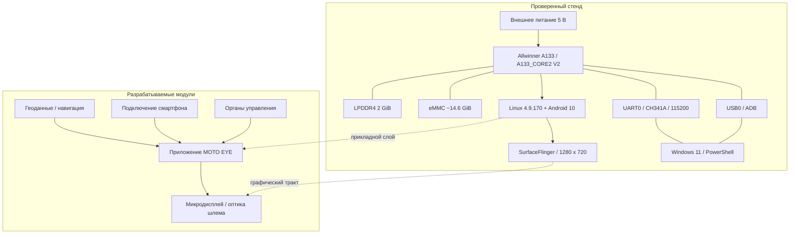

# Архитектура MOTO EYE

## 1. Принцип модульного разделения

MOTO EYE разрабатывается как система из независимых уровней: аппаратное обеспечение; загрузочная и операционная среда; системные сервисы и каналы данных; прикладное визуальное представление; оптический и механический интерфейс. В текущей итерации достоверно реализованы первые два уровня и диагностические каналы третьего. Это архитектурное разделение предотвращает смешение «работает Android» с «работает готовый HUD».



Сплошные связи в секции «Проверенный стенд» означают наблюдаемую функциональность, а пунктирные — будущие интеграции или логическую зависимость.

## 2. Загрузочная архитектура

В журналах зафиксированы этапы аппаратной инициализации DRAM, обнаружение MMC-носителя, загрузка U-Boot 2018.05, переход к Linux 4.9.170, запуск первого и второго этапов Android init, монтирование системных разделов, загрузка политик SELinux и графических сервисов. Физическая инфраструктура загрузки формирует базу для проверки отказов на соответствующем уровне.

| Уровень | Роль | Наблюдаемый индикатор |
| --- | --- | --- |
| BOOT0 | Начальная инициализация SoC | `HELLO! BOOT0 is starting!` |
| DRAM | Тренировка/проверка памяти | `DRAM simple test OK` |
| Storage | Доступ к eMMC | `MMC 5.1`, `mmcblk0` |
| U-Boot | Загрузка ядра и DT | `Starting kernel ...` |
| Linux | CPU, драйверы, ФС | `Brought up 4 CPUs` |
| Android init | Сервисы системы | `init second stage started!` |
| Android runtime | Завершение загрузки | `sys.boot_completed=1` |
| Graphical stack | Формирование изображения | `SurfaceFlinger`, `screencap` |

## 3. Контуры управления

**Контур А — UART (низкоуровневый).** Нужен, когда USB и Android ещё не подняты. Позволяет видеть BOOT0, U-Boot, kernel и shell. Стенд работал через CH341A с COM6 и 115200 8N1. Отсутствие текста в UART не доказывает выключенное питание без дополнительной проверки.

**Контур Б — USB ADB (операционный).** Доступен после загрузки Android и запуска `adbd`. Обеспечивает интерактивный shell, чтение свойств ОС, системных логов, управление приложениями, снятие кадров. На текущем образе доступен root; в продуктовой эксплуатации такой режим следует ограничить.

**Контур В — интерфейс конечного устройства (планируется).** Управление от органов ввода, получение данных смартфона и датчиков, отрисовка HUD на выбранной матрице. Ни один из этих контуров пока не подтверждён экспериментально.

## 4. Планируемая программная структура

```text
MOTO EYE Android application (план)
  ├─ Presentation / HUD renderer
  ├─ Domain / speed, route, alerts
  ├─ Data providers / phone, GNSS, sensors
  ├─ Connectivity / pairing and protocol
  ├─ Safety layer / priority, timeouts, failsafe
  └─ System integration / autostart, kiosk, telemetry
```

Для HUD предлагается проектировать отдельный слой представления, независимый от источников данных. Тогда навигационный тестовый поток можно будет заменить реальным GNSS или смартфоном без переработки визуализации. Критические сообщения должны иметь конечное время показа и не закрывать центральную область обзора; детали будут определяться после изучения оптики и сценариев управления.

## 5. Ограничения архитектуры

- Логический Display 0 не является доказательством подключённого MIPI/HDMI/LVDS дисплея.
- Отсутствующий IP-адрес, кроме 127.0.0.1, означает, что сетевой канал на дату проверки не был введён в эксплуатацию.
- Прошивка содержит элементы для периферии конкретной конфигурации производителя: часть драйверов выводит ошибки при отсутствии соответствующего устройства.
- Поддержка внешних датчиков, камер, BLE, GNSS и аудиосистемы описывает требования, а не готовые интерфейсы.

## 6. Условия перехода к следующей итерации

1. Задокументировать электрическую схему USB0 и питания с измерениями.
2. Зафиксировать длительную работоспособность системы под нагрузкой с журналом отключений.
3. Идентифицировать и испытать один физический дисплей на отдельном стенде.
4. Создать минимальное приложение с тестовым HUD и запуском через ADB.
5. Описать интерфейс обмена данными с телефоном и режим работы при потере связи.
