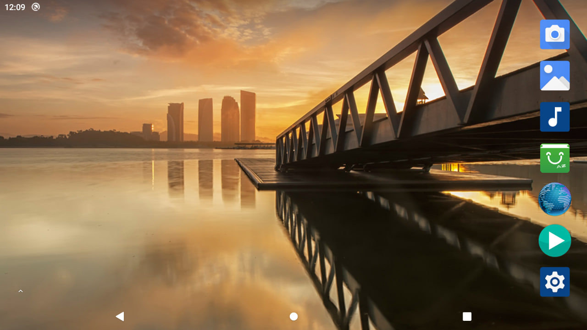

# MOTO EYE — инженерный отчёт о формировании вычислительной платформы

> **Редакция:** 0.1 · **Дата фиксации:** 4 ноября 2026 года  
> **Объект:** модуль A133_CORE2 V2 на SoC Allwinner A133  
> **Этап:** запуск аппаратно-программного стенда и подтверждение удалённого управления Android

## Аннотация

В рамках разработки MOTO EYE проведён комплекс работ по исследованию, восстановлению и первичной верификации автономной вычислительной платформы для будущей системы отображения информации в мотошлеме. В качестве аппаратного основания использован системный модуль A133_CORE2 V2 с процессором Allwinner A133, оперативной памятью LPDDR4 и встроенным накопителем eMMC. Работа велась на минимальном стенде без штатного подключённого дисплея: это потребовало последовательно освоить загрузку SoC, аппаратную диагностику UART, восстановление программного обеспечения и взаимодействие с Android через USB Debug Bridge.

В ходе исследования изучены поставленные изготовителем архивы, выделен подходящий заводской образ Android 10, подготовлен инструмент записи PhoenixSuit, восстановлена возможность загрузки системы с eMMC, найдены диагностические выводы UART0, локализованы условия воспроизведения отдельных циклических сбросов и получен стабильный USB ADB-доступ к платформе с привилегиями суперпользователя. На заключительном этапе зарегистрированы 667,73 секунды непрерывной работы Android при активном подключении к компьютеру; программным способом создан кадр рабочего стола с геометрией 1280 × 720 пикселей.

Результат работы — воспроизводимая **программная платформа для дальнейшего создания HUD**. Он не является готовым носимым устройством: пока не подтверждены работа физической матрицы, оптическая схема, пользовательское HUD-приложение, интеграция навигации и датчиков, температурная и вибрационная устойчивость.

## 1. Предпосылки и постановка задачи

Современный мотошлем может выступать не только защитным элементом, но и носителем компактной визуальной информационной системы. Основное требование к такому решению — предоставлять критически значимые сведения в нужный момент, не превращая поле зрения пользователя в перегруженный экран. Для технической реализации необходимы вычислительная подсистема, графический конвейер, источник питания, датчики, канал связи и дисплей с подходящей оптикой.

В MOTO EYE было принято разделить проект на два последовательных направления. Первое — обеспечить надёжную загрузку и контроль вычислительного модуля. Второе — реализовать собственно носимое устройство. Такое разделение снижает риск: без проверенной программной основы невозможно обоснованно оценивать требования к экрану, производительности или интерфейсу.

**Цель текущего этапа:** получить управляемую платформу Android на базе A133_CORE2 и подтвердить независимость диагностики от физического экрана.

Для достижения цели были сформулированы задачи:

1. Идентифицировать аппаратную ревизию платы и базовые характеристики.
2. Найти документацию и программное обеспечение, относящиеся к конкретной конфигурации.
3. Подготовить безопасное электрическое питание и диагностический канал.
4. Исследовать загрузочную цепочку и состояние встроенной памяти.
5. Выполнить восстановление/перезапись программного образа подходящим инструментом.
6. Получить интерактивную консоль ОС, определить характер возможных отказов.
7. Обеспечить подключение Android к ПК через ADB, проверить привилегии и графический стек.
8. Зафиксировать результаты так, чтобы дальнейшая разработка не зависела от неформальных заметок.

## 2. Аппаратная база

В работе использован отдельный модуль с маркировкой **A133_CORE2**, рассматривавшийся в документации и рабочей переписке как ревизия V2 с 80 внешними контактами. На модуле установлен SoC Allwinner A133. Логи загрузки подтверждают запуск четырёх процессорных ядер и инициализацию 2048 Мбайт LPDDR4 на частоте DRAM 792 МГц. Встроенная eMMC определяется как MMC 5.1 объёмом 14,6 GiB (показатель, выдаваемый Linux); загрузчик сообщает ёмкость порядка 14 912 MB. Эти величины выражены в разных единицах и не противоречат друг другу.

В загрузке участвует система управления питанием **AXP803**. Её наличие подтверждается как BOOT0/U-Boot, так и драйвером ядра Linux. В логе присутствуют диагностические сообщения регуляторов, часть из которых связана с несовпадением описаний устройства и используемых драйверов. Их нельзя автоматически трактовать как отказ конкретного стабилизатора, особенно если Android продолжает работу.

Поскольку на стенде не было выведено изображение на внешний дисплей, основными инструментами наблюдения стали UART0 и USB0. Первоначальное физическое подключение было выполнено вручную. Наблюдаемая успешная работа отдельного экземпляра не означает, что все выводы можно без проверки переносить на любую версию платы.

Подробности: [аппаратная платформа](hardware.md), [электропитание и USB](power-and-usb.md).

## 3. Исследование программного комплекта производителя

Исходные материалы были получены из китайского архива **REVB-A133资料**. С практической точки зрения этот этап оказался не просто скачиванием файла, а отдельной задачей инженерного обеспечения: доступ осуществлялся через Baidu Netdisk; работа штатного клиента и BaiduPCS-Go сопровождалась проблемами авторизации и ограниченной скоростью передачи. Часть загрузок требовала докачивания. Для автоматизации ранее был подготовлен вспомогательный комплект `MotoEye_A133_AutoDownload.zip` с PowerShell-загрузчиком, однако он не является частью текущей прошивки и не нужен при штатном ADB-доступе.

После получения пакета были выделены следующие классы материалов:

- пользовательские и аппаратные руководства REVB-A133-V2;
- схемы и описания распиновки A133-Core2;
- экранные конфигурации, в том числе DTS для отдельных панелей;
- архивы Android 10 под разные ревизии и видеовыходы;
- инструменты PhoenixSuit и USB-драйверы Allwinner.

На этапе подготовки проверялась совместимость образа с реальной конфигурацией модуля. По предшествующим записям аппаратная конфигурация Wi-Fi была идентифицирована как **AW869A**, после чего для восстановления был выбран пакет `REVB-A133V2-HDMI720P-AW869A-202302.zip`, содержащий `REVB-A133V2-HDMI720P-AW869A-202302.img`. В архивной истории отмечены распаковка изображения, проверка SHA-256 при переносе и работа с PhoenixSuit V1.0.7. Само числовое значение SHA-256 в доступных материалах не зафиксировано, поэтому оно в настоящем отчёте не приводится.

Версия прошивки относится к заводскому программному комплексу, а не к исходным кодам MOTO EYE. Нельзя автоматически считать, что её HDMI-профиль соответствует будущему микродисплею. Допустимый видеовыход и конфигурацию device tree для выбранной матрицы необходимо будет определить отдельно.

## 4. Восстановление и загрузка

Для перевода платформы в режим низкоуровневого обслуживания применялся механизм **FEL**, характерный для семейства Allwinner. На некоторых стадиях Windows обнаруживала устройство с идентификатором `1F3A:EFE8`. В другие моменты возникала ошибка нумерации USB с `VID_0000:PID_0002` (ошибка дескриптора, код 43), а в отдельные попытки устройство не отображалось вовсе. Такие симптомы не указывают однозначно на повреждение флеш-памяти: их могли вызывать состояние USB, физическое соединение, питание, драйверы или режим загрузки.

Работа с PhoenixSuit включала установку фирменного приложения и драйверов, устранение проблем установщика Windows и выбор соответствующего образа Android. Часть операций выполнялась в повышенном контексте. Итоговый успешный запуск Android после перепрошивки отмечен в продолжении истории проекта; полного программного журнала операции записи в исходном наборе нет. Поэтому результат подтверждён фактом загрузки соответствующей системы, но точный порядок всех записанных разделов, настройки форматирования и хеш финального образа следует считать незафиксированными.

Отладочные логи показали устойчивую цепочку:

```text
BOOT0
  └─ DRAM init: LPDDR4, 2048 MB, test OK
      └─ MMC 5.1 / eMMC discovered
          └─ U-Boot 2018.05
              └─ Linux 4.9.170 (AArch64, four CPUs)
                  └─ Android init (first/second stage)
                      └─ SELinux / system/vendor/product / data
                          └─ SurfaceFlinger / boot animation
                              └─ sys.boot_completed=1
```

В одном из журналов Android достигал `sys.boot_completed=1` через ≈22,7 секунды после запуска ядра. На основании этого можно заключить, что распаковка системных разделов, базовая инициализация сервисов и переход в рабочее состояние происходили успешно.

## 5. Организация низкоуровневой диагностики

Для работы с последовательной консолью применён программатор/адаптер **CH341A Pro** в режиме UART с логическими уровнями **3,3 В**. На ранней стадии драйвер Windows распознавал адаптер как устройство другого класса (`usbprint.inf`), а не как последовательный COM-порт. После корректировки режима и драйвера адаптер начал определяться как COM; в процессе испытаний встречались COM3, COM4, затем COM6.

На рабочем экземпляре успешно использован UART0:

- вывод 44 платы → RXD адаптера (сообщения платы на ПК);
- вывод 45 платы ← TXD адаптера (команды с ПК);
- вывод 41 → GND адаптера;
- линия питания VCC адаптера **не подключалась** к модулю;
- параметры передачи: **115200 бит/с, 8 бит данных, без чётности, 1 стоповый бит**.

Наличие одностороннего потока не сразу гарантировало двустороннее управление: первые попытки отправлять команды во время старта Android выполнялись слишком рано, пока shell ещё не был готов. В дальнейшем диагностические запросы с метками `===DIAG===`/`===END===` успешно исполнились в интерактивной консоли `console:/ $`. Это подтвердило корректность электрического и программного канала UART в обе стороны.

В отдельных длинных копиях журналов встречались повреждённые символы. При этом большая часть последовательности сохранила правильные сообщения и временные отметки. Причину искажений отдельно не измеряли; делать вывод о неисправности RAM или ядра только по этим знакам нельзя.

## 6. Исследование нестабильности и циклических сбросов

В промежуточной конфигурации наблюдались перезапуски примерно через 20–25 секунд. В соответствующем журнале присутствовали признаки полноценной загрузки Android, окончание boot animation и затем новый `HELLO! BOOT0 is starting!`. Этот факт отличает сброс питания или аппаратный/системный рестарт от обычного падения одного приложения. Однако сам по себе повторный BOOT0 не определяет конкретный механизм сброса.

Особое внимание привлекло соседство строк:

```text
[   23.689570] axp803_usb_power: current limit setted: usb pc type
[138]HELLO! BOOT0 is starting!
```

Их временная близость была основанием для гипотезы о влиянии USB0/PMU, но не прямым доказательством неисправного питания. При последующей проверке без USB0 последовательный журнал прошёл отметку 26,7 секунды без нового BOOT0, а позже зафиксированы сообщения ядра с таймстампом свыше 120 секунд. Это усилило подозрение о зависимости сбросов от физической конфигурации стенда.

**Критически важное уточнение:** в более поздней конфигурации тот же стенд успешно работал **с подключённым USB ADB** более 667 секунд. Следовательно, утверждение «USB0 вызывает перезагрузку» было бы неверным. Правильный вывод: *в ранних тестах сброс коррелировал с некоторыми вариантами подключения и/или переходными процессами, но воспроизводимая причина окончательно не установлена*. Для окончательного заключения потребуются замеры напряжений и тока, фиксация состояния USB0 VBUS, чтение регистров причины сброса PMU и длительный повторяемый тест.

Дополнительно в логах встречаются:

- `rtc-pcf8563 ... probe failed` — внешний RTC не ответил на I²C;
- сообщения о недоступных Wi-Fi/BT GPIO/регуляторах;
- ошибки дисплейного узла `unable to map de registers`;
- повторяющиеся запросы к отсутствующему `android.hardware.radio@1.4::IRadio/slot1`;
- сообщения о тачскрине `ft5x16_ts.ko` и I²C.

Эти сообщения являются объектами дальнейшего анализа, но **не препятствуют подтверждённому запуску Android** и **не получили доказанной причинно-следственной связи с ранними сбросами**.

## 7. Установление ADB-доступа

После проверки конфигурации ОС через UART получены значения `sys.boot_completed=1`, `sys.usb.config=adb`, `sys.usb.state=adb`, `init.svc.adbd=running`. На этом этапе у Android не было обнаружено сетевого IPv4-интерфейса, кроме loopback (`127.0.0.1`), поэтому использовался проводной USB ADB, а не отладка по TCP/IP.

На компьютере под Windows 11 установлен **Android SDK Platform-Tools**. Успешное подключение подтверждено результатом:

```text
List of devices attached
[device-serial-redacted]  device  product:ceres_c3  model:QUAD_CORE_A133_c3  device:ceres-c3
```

С помощью удалённой оболочки получены:

```text
getprop sys.boot_completed         → 1
cat /proc/uptime                   → 667.73 2425.89
getprop ro.build.version.release   → 10
id                                  → uid=0(root), ... context=u:r:su:s0
```

Такой набор данных подтверждает не только наличие устройства в диспетчере Windows, но и реальный обмен с запущенной Android, а также предоставление привилегий root. Наличие root удобно для стендовой диагностики, но для будущего устройства потребуются ограничения доступа и пересмотр политики безопасности.

## 8. Проверка графической подсистемы

Следующим этапом выполнена программная проверка графического стека. Команды `wm size` и `wm density` вернули **1280x720** и **200 dpi**. В выводе `dumpsys SurfaceFlinger` присутствует **Display 0 (HWC display 0)**. На устройство был вызван системный механизм `screencap`, после чего PNG передан на ПК средствами `adb pull`.

Полученный кадр показал стандартный рабочий стол Android с фоновым изображением, панелью навигации и иконками предустановленных приложений. Это свидетельствует о работоспособности Android WindowManager/SurfaceFlinger на уровне формирования изображения и доступности кадрового буфера для программного захвата. В перечне сторонних приложений присутствовали `com.estrongs.android.pop` и `cn.goapk.market`.



*Рисунок 1 — рабочий стол Android 10, снятый на проверяемом модуле A133_CORE2 через ADB.*

**Граница доказательства:** на этом этапе к модулю не подключена и не испытана целевая физическая микропанель. Снимок экрана не подтверждает работоспособность конкретного HDMI-, MIPI DSI- или LVDS-тракта. Перед изготовлением оптического узла необходимо определить тип и электрические параметры дисплея.

## 9. Принципы воспроизводимости

Для развития аппаратного проекта принципиально важно разделять наблюдение, диагностическую гипотезу и подтверждённое техническое решение. В настоящем репозитории это разделение выполнено в явном виде:

- **Наблюдение** — строка консоли, ответ ADB, скриншот или результат измерения с указанием условий.
- **Интерпретация** — объяснение того, что логически следует из наблюдения.
- **Гипотеза** — возможная причина, которая требует дополнительного эксперимента.
- **Проектное решение** — осознанный выбор дальнейшего направления с условиями пересмотра.

Исходные пользовательские журналы не публикуются целиком в первоначальном виде: они могут содержать серийный номер, системные идентификаторы или иную конфигурационную информацию. Вместо этого приводится редактированная копия UART-журнала и проверяемые выдержки. Прошивки, архивы китайского производителя и драйверы не переупаковываются в исходный код проекта.

Набор PowerShell-скриптов рассчитан на повторение **без записи в загрузочные разделы**. Чтение конфигурации, получение логов и сохранение изображения отделены от любых потенциально необратимых операций.

## 10. Достигнутый результат и ограничения

На рассматриваемом этапе доказано, что платформа A133_CORE2 V2 в исследованной конфигурации способна загрузить Android 10 из eMMC, предоставить интерактивную UART-консоль, установить USB ADB-соединение с Windows, выполнить команды оболочки с root-привилегиями и сформировать полноразмерное изображение рабочего стола.

Важным инженерным результатом является переход от непрозрачного состояния «плата не подаёт признаков работы» к инструментально управляемой системе, для которой доступны журналы загрузки, информация о процессах, свойства Android, службы и механизм снятия экранных кадров. Это существенно сокращает стоимость дальнейших экспериментов: прикладное ПО можно будет разрабатывать и тестировать, не полагаясь на случайную работоспособность дисплейного модуля.

При этом сохраняются задачи, без которых система не может быть признана готовой к реальному использованию:

1. Верификация электрической схемы питания, VBUS, защит и переходных процессов USB.
2. Продолжительный тест стабильности при разных нагрузках и сценариях подключения.
3. Подбор дисплея и согласование физического интерфейса, таймингов, контрастности и оптики.
4. Разработка Android-приложения с HUD-рендерингом и управлением жизненным циклом.
5. Интеграция достоверных данных о скорости, маршруте и состояниях связи.
6. Проектирование защищённой носимой конструкции, питания, теплоотвода и интерфейсов пользователя.
7. Оценка безопасности взаимодействия во время движения, читаемости и недопустимости перекрытия обзора.

## Заключение

Создана и подтверждена работающая программно-аппаратная база MOTO EYE: модуль A133_CORE2 с Android 10, двусторонней UART-консолью, USB ADB и графическим выводом 1280 × 720. Успешная диагностика и восстановление программной среды позволяют перейти от низкоуровневого исследования к разработке специализированного программного обеспечения и экспериментам с дисплеем.

Наиболее значимым результатом стало не одно успешное включение платы, а наличие воспроизводимого набора доказательств: журналов BOOT0/U-Boot/Linux/Android, полученных ответов интерактивной оболочки, подтверждения ADB, контроля uptime и реального кадра графической системы. Именно этот набор определяет исходную инженерную точку для следующей стадии работы.

---

**Приложения:** [матрица проверки](verification.md) · [история испытаний](development-journal.md) · [восстановление прошивки](firmware-and-recovery.md) · [достоверность источников](sources-and-provenance.md) · [дальнейшая разработка](roadmap.md).
