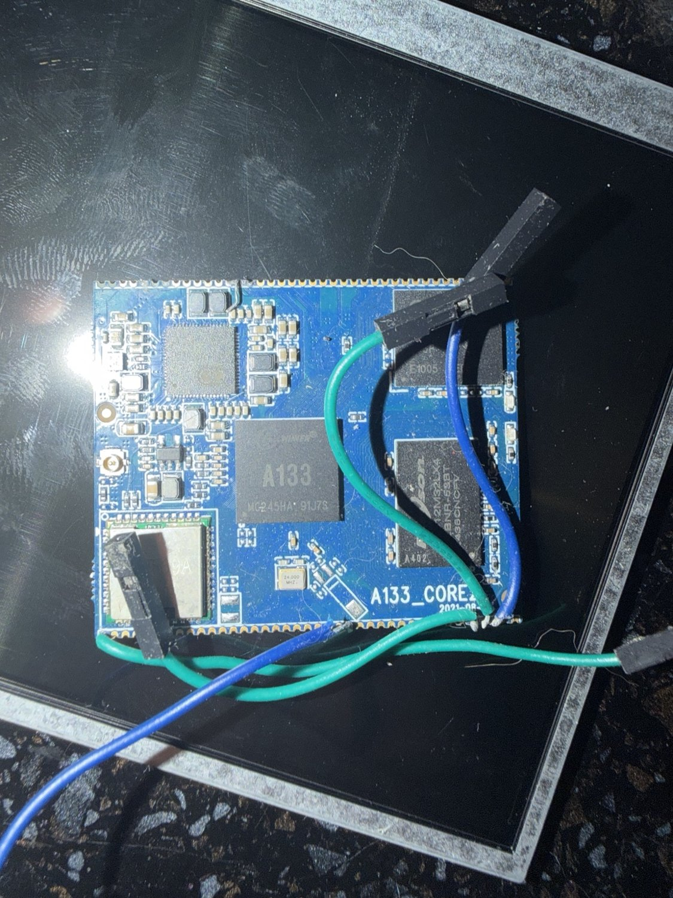

# Аппаратная платформа A133_CORE2 V2

## 1. Идентификация модуля

Испытательный объект — 80-контактный системный модуль **A133_CORE2**, используемый в документации пакета REVB-A133-V2. Маркировка A133 видна на фотографии стенда; принадлежность к варианту Core2/V2 восстановлена по архивной рабочей документации и фотографиям. Реальный экземпляр содержит распаянные микросхемы памяти и дополнительный радиомодуль (ранее идентифицирован как AW869A). Поддержка Wi-Fi/BT в запущенном Android отдельно не тестировалась.

*Рис. 1 — реальный модуль на экспериментальном стенде. Фото не используется как электрическая схема и не позволяет надёжно определить номера всех контактных площадок.*

## 2. Подтверждённые характеристики

| Параметр | Подтверждение | Значение |
| --- | --- | --- |
| SoC | BOOT0 / Linux | Allwinner A133, `sun50iw10` / `sun50iw10p1` |
| Ядра CPU | Linux | 4 × ARM Cortex-A53 (по ID `410fd034`, без независимого теста частот под нагрузкой) |
| RAM | BOOT0 / Linux | LPDDR4, 2048 Мбайт |
| Частота DRAM на загрузке | BOOT0 | 792 МГц |
| Встроенный накопитель | BOOT0 / Linux | eMMC 5.1, 14.6 GiB в Linux |
| PMU | U-Boot / Linux | AXP803 |
| Bootloader | UART | U-Boot 2018.05 |
| Ядро | `dmesg` / UART | Linux 4.9.170, AArch64 |
| ОС | ADB | Android 10 |
| Графика | ADB | Display 0, 1280 × 720, 200 dpi |

Указанные параметры принадлежат этому экземпляру и конкретному программному образу; они не являются универсальной спецификацией всех плат семейства A133.

## 3. Рабочие выводы стенда

Ниже — **зафиксированная в истории проекта карта соединений**, по которой получены UART-логи и USB-доступ. Для повторного монтажа необходимо проверить нумерацию и назначение по **оригинальному документу `A133-Core2核心板引脚说明.pdf` именно для V2**. Особенно важно не полагаться на назначение контактной площадки без установления ориентации модуля.

| Контакт модуля | Сигнал в рабочей записи | Использование |
| ---: | --- | --- |
| 39, 40 | DC5V | Вход питания модуля от отдельного 5 В источника |
| 41 | GND | Общая земля UART |
| 44 | UART0_TX | Передача загрузочного лога к RXD адаптера |
| 45 | UART0_RX | Приём команд от TXD адаптера |
| 25 / 28 | GND | Общая земля USB0 (согласно исторической карте) |
| 26 | USB0_DM | D− USB0 |
| 27 | USB0_DP | D+ USB0 |
| 33 | USB0_VBUS | **Назначение по архивной карте; топология питания не верифицирована** |
| 78 / 79 | USB1_DP / USB1_DM | В прошлой карте — отдельный USB host, не USB0 ADB |
| 80 | GND | Общая земля |

**Предостережение.** Доступная в текущем наборе схема `RER-A133-Core-原理图.pdf` относится к другому комплекту/ревизии и не заменяет подробную схему именно A133_CORE2 V2. Отдельный документ V2 назван в архиве разработки, но его полный оригинал не включён в этот репозиторий. Поэтому таблица является результатом предшествующей диагностики, а не новым независимым электрическим аудитом.

## 4. Подключение UART0

В испытанном варианте использован CH341A Pro, настроенный на последовательный порт **115200 8N1**, логический уровень **3,3 В**. Подключение выполнялось перекрёстно по TX/RX: передача платы на приём адаптера, передача адаптера на приём платы, общая земля. Напряжение питания от программатора (`VCC`) **не подключалось** к модулю.

Подготовка и включение платы должны выполняться без «горячего» переподключения оголённых проводов. Необходимо проверять, что адаптер действительно переведён в UART-режим 3,3 В: название CH341A само по себе не гарантирует безопасного уровня на всех выводах.

## 5. Подключение USB0

По результатам ADB на ПК установлен работающий канал USB0 ↔ Android. Его электрическая реализация требует отдельной проверки линий VBUS, питания и защиты. **Не допускается автоматически соединять два выхода +5 В: порт ПК и внешний блок.** До окончательного монтажа необходимо выяснить, является ли `USB0_VBUS` на данном модуле входом детектирования или электрически связан с силовым трактом. Наличие успешного ADB-доступа не снимает этого требования.

Подробнее: [питание и USB](power-and-usb.md).

## 6. Дисплей и периферия

В настоящий момент реального соединения с целевым микродисплеем нет. Прежде чем проектировать печатный адаптер, требуется установить маркировку матрицы, интерфейс (MIPI DSI, LVDS, RGB или другой), напряжения линий, питание подсветки/излучателя, разъём и соответствие DTS. Подключение шлейфа «по похожей форме» недопустимо.

Wi-Fi/BT, GNSS, камеры и дополнительные органы управления также не подтверждены испытаниями; соответствующие блоки входят в [план развития](roadmap.md).
