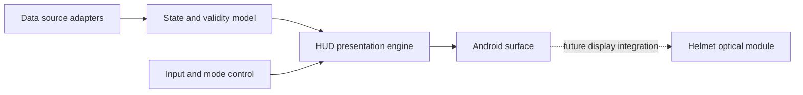

# Концепция пользовательского интерфейса MOTO EYE

> Этот раздел описывает **целевое поведение будущего продукта**. Экран шлема и собственное HUD-приложение в текущей аппаратной итерации ещё не построены.

## 1. Продуктовая идея

MOTO EYE рассматривается как система, выводящая ограниченный набор сведений непосредственно в поле зрения водителя. Главный принцип — информация должна помогать принятию решения, не конкурируя за внимание с дорожной обстановкой. Поэтому задача не сводится к переносу интерфейса смартфона на маленькую матрицу: нужен самостоятельный дизайн сообщений, приоритетов и режимов.

Возможная рабочая модель — модуль A133 под Android, графический интерфейс HUD и связь со смартфоном или собственными источниками телеметрии. Систему необходимо проектировать с учётом ограниченных габаритов, яркого солнца, ночной езды, перчаток, вибраций, погодных условий и шумового окружения. Любое отображение должно быть отключаемым.

## 2. Предварительные сценарии

| Сценарий | Предлагаемая информация | Условие отображения |
| --- | --- | --- |
| Движение | Скорость (при наличии достоверного источника) | Компактный режим, без постоянной анимации |
| Навигация | Стрелка поворота и расстояние до манёвра | Короткое сообщение рядом с событием |
| Коммуникации | Уведомление о вызове/сообщении | Только некритичный минимум, без длинного текста |
| Состояние системы | Батарея, связь, статус GPS | При изменении или по запросу |
| Сбой источника | «Нет данных» вместо старого значения | Немедленное снятие недостоверной информации |

Ни один из источников данных не подключён и не проверен. Значения, получаемые из автомобиля, смартфона или GNSS, должны иметь индикаторы достоверности и времени обновления.

## 3. Информационная иерархия

Первый уровень — действия, требующие ближайшего внимания (например, направление следующего манёвра). Второй — краткие контекстные состояния. Третий — информационные настройки и статистика, которые лучше выводить вне движения. Центральную часть обзора следует сохранять максимально свободной, а сообщения ограничивать по длительности и числу одновременно видимых элементов.

## 4. Требования к графике

- Контрастность должна оцениваться **на реальном оптическом устройстве** при солнце и в темноте, а не по скриншоту с ПК.
- Цвет не должен быть единственным способом кодирования важных состояний; необходима форма/иконка/текст.
- Анимации — короткие, без мерцания и резких перемещений.
- Перегруженные панели, мелкий шрифт, полноэкранные карты и тексты сообщений не должны становиться основным режимом HUD.
- В условиях отсутствия данных предпочтительно убрать индикатор либо явно показать его недостоверность.
- Требуется отдельная проверка задержки отображения и читаемости при вибрации.

## 5. Варианты источников данных (для исследований)

**Смартфон:** получение маршрута и уведомлений через отдельный протокол связи. **GNSS:** собственный модуль или координаты телефона, при этом скорость и положение требуют проверки качества сигнала. **Транспортные данные:** только через явно совместимые и проверенные интерфейсы. **Органы управления:** кнопки или иной безопасный интерфейс, пригодный для перчаток. Их наличие в будущей версии не означает, что соответствующее оборудование уже установлено.

## 6. Предполагаемая модульность Android-приложения

Для начала достаточно создать приложение, выводящее на 1280 × 720 тестовые данные: условную скорость, стрелку и индикатор связи. Такой прототип позволит проверить масштабирование, типографику и жизненный цикл приложения даже до подключения физического дисплея. Работоспособность в эмуляции/снимке не заменяет эксплуатационных испытаний.

## 7. Ограничения использования

Проект не должен требовать от водителя совершать сложные действия во время движения. В будущем необходимо учесть применимые правила дорожного движения, требования к защитным характеристикам шлема и влияние оптики на обзор и посадку. Встраиваемый узел не должен ослаблять конструкцию сертифицированного шлема без надлежащей инженерной оценки.
