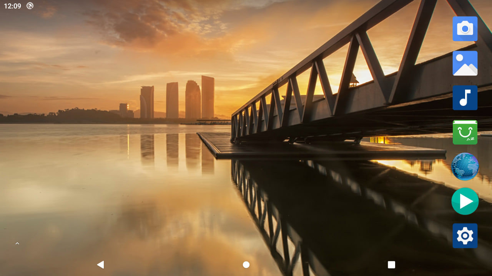

# Протокол верификации стенда

> **Срез:** 04.11.2026 · **Контекст:** Windows 11, A133_CORE2 V2, Android 10, CH341A UART, USB ADB  
> **Метод:** сопоставление исходных UART-журналов, реальных ответов ADB и программно снятого изображения.  
> **Статусы:** `PASS` — подтверждено; `PARTIAL` — ограниченное свидетельство; `OPEN` — не проверено.

## 1. Матрица результатов

| ID | Проверка | Наблюдение / критерий | Статус |
| --- | --- | --- | --- |
| HW-01 | Чтение идентификатора SoC | `chip id is 0x1400`, `sun50iw10p1` | PASS |
| HW-02 | Объём и тип оперативной памяти | `LPDDR4`, `2048 MBytes`, `DRAM simple test OK` | PASS |
| HW-03 | Доступность eMMC | `MMC 5.1`, `mmcblk0`, `14.6 GiB` | PASS |
| BOOT-01 | Запуск U-Boot | `U-Boot 2018.05` | PASS |
| BOOT-02 | Запуск ядра Linux | `Linux version 4.9.170`, `Brought up 4 CPUs` | PASS |
| OS-01 | Инициализация Android | `sys.boot_completed=1` | PASS |
| UART-01 | Чтение UART0 на ПК | `HELLO! BOOT0 is starting!` на COM6 | PASS |
| UART-02 | Двусторонний обмен | Маркеры `===DIAG===` и `===END===` в shell | PASS |
| USB-01 | Сервис ADB в системе | `init.svc.adbd=running`, `sys.usb.state=adb` | PASS |
| USB-02 | Нумерация ADB на Windows | `adb devices -l` показывает `device` | PASS |
| USB-03 | Продолжительная устойчивость USB | 667.73 с uptime во время работающего USB ADB | PARTIAL |
| OS-02 | Версия ОС | `ro.build.version.release=10` | PASS |
| OS-03 | Доступ суперпользователя | `uid=0(root)`, `context=u:r:su:s0` | PASS |
| GFX-01 | Разрешение | `Physical size: 1280x720` | PASS |
| GFX-02 | Плотность экрана | `Physical density: 200` | PASS |
| GFX-03 | Графический сервис | `Display 0 (HWC display 0)` | PASS |
| GFX-04 | Кадр изображения | PNG 1280 × 720 через ADB | PASS |
| DISP-01 | Физический видеовыход | Матрица не подключена | OPEN |
| PWR-01 | Топология USB0_VBUS | Оригинальная схема Core2 V2 в этой публикации не подтверждена | OPEN |
| PWR-02 | Причина ранних ребутов | Сброс наблюдался, причина не локализована | OPEN |
| SYS-01 | Устойчивость под нагрузкой | Нет методики/серии циклов | OPEN |
| HUD-01 | Собственный HUD | Нет работающего APK на дату среза | OPEN |

## 2. Контрольные данные

### UART-диагностика

```text
[    4.047384] init: init second stage started!
console:/ $ ...
===DIAG===
reboot
running
7.14 17.19
===END===
[   22.677173] init: processing action (sys.boot_completed=1)
```

В этом фрагменте `reboot` относится к одному из полученных свойств загрузки, а не к выполненной команде `reboot` — диагностический запрос содержал `getprop ro.boot.bootreason` и другие свойства. Из-за нескольких пустых строк при выводе нужно рассматривать исходный полный журнал; вывод не доказывает причину аппаратного сброса.

### USB и root

```text
List of devices attached
[REDACTED]    device product:ceres_c3 model:QUAD_CORE_A133_c3 device:ceres-c3

getprop sys.boot_completed       => 1
cat /proc/uptime                 => 667.73 2425.89
getprop ro.build.version.release => 10
id                               => uid=0(root) gid=0(root) ... context=u:r:su:s0
```

### Графика

```text
wm size               => Physical size: 1280x720
wm density            => Physical density: 200
SurfaceFlinger        => Display 0 (HWC display 0)
pm list packages -3   => com.estrongs.android.pop; cn.goapk.market
```



## 3. Наблюдения о перезагрузках

**Эпизод А (ранний):** сразу после успешной инициализации Android появлялся новый BOOT0 примерно через 23–24 с. Рядом находится сообщение `axp803_usb_power` о типе USB PC. Паника ядра в видимой части журнала не обнаружена.

**Эпизод Б (контроль без USB0):** система проходит 26,7 с без сброса; позже отдельный вывод UART содержит метки `[120.x]`, `[121.x]` при продолжении работы. Это **не** равно доказательству безусловно стабильной конфигурации на часы.

**Эпизод В (итоговый):** ADB через USB определяется как `device`; uptime составляет **667,73 с**, Android завершил загрузку. Следовательно, ранняя нестабильность не воспроизводилась неизбежно при любом USB-подключении.

## 4. Достоверность и ограничения измерений

- Показание `uptime` фиксирует наблюдаемую продолжительность **одного** сеанса. Оно не заменяет soak-тест.
- Часть UART-записей содержит неверные символы, появившиеся при передаче/копировании; числовые результаты проверены по читаемым строкам.
- Не проводились измерения времени ответа графики, FPS, потребления энергии, температуры чипа, точности времени или задержки датчиков.
- Физический видеовыход, питание VBUS и надёжность в мотошлеме не подтверждены.

## 5. Рекомендуемые критерии следующей версии

| Направление | Предлагаемый критерий приёмки |
| --- | --- |
| Питание | Осциллограммы DC5V/VBUS при холодном старте и USB hotplug |
| Стабильность | ≥24 ч без непредвиденных reset на эталонном стенде |
| Видео | Реальная панель выводит тестовую таблицу без артефактов |
| Приложение | HUD APK запускается повторяемо из ADB и переживает перезагрузку |
| Навигация | Демонстрационный поток данных и корректная обработка потери сигнала |
| Публикация | Полная схема подключения, хеш прошивки, версия DTS и протокол проверки |

*Критерии следующей версии — проектные требования, а не выполненные результаты.*
